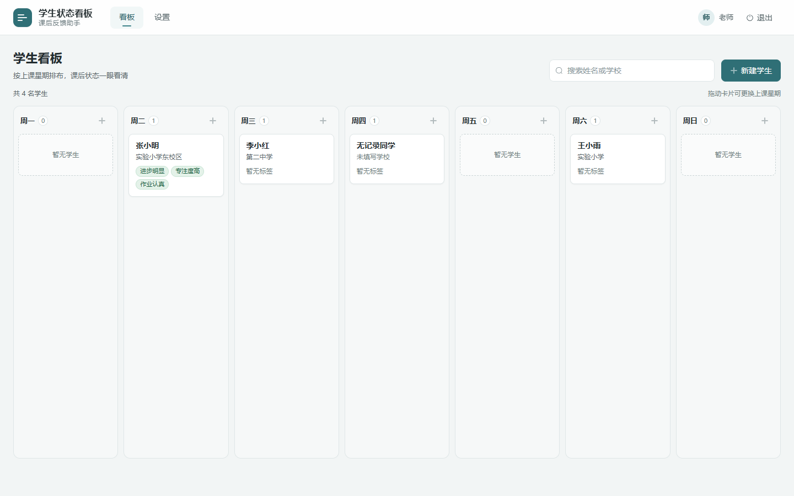
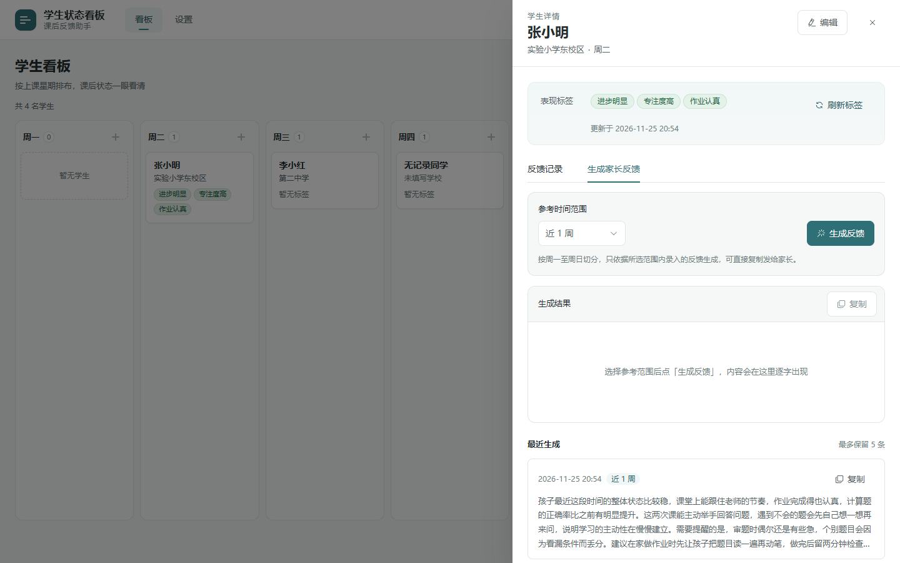
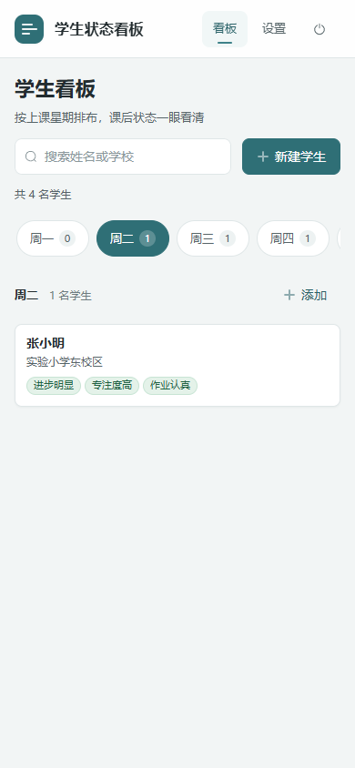
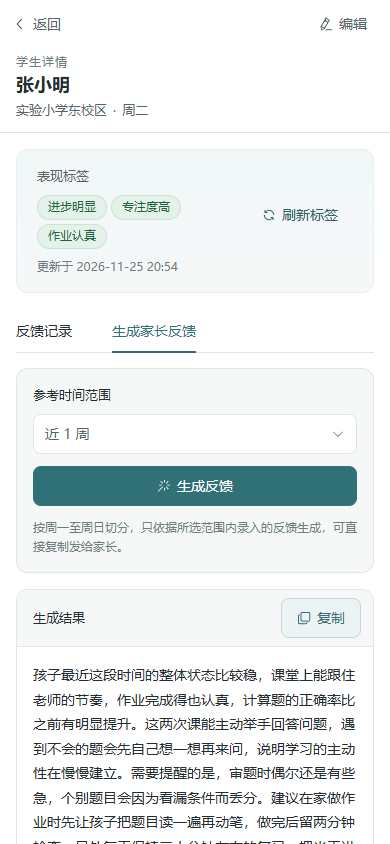

# 学生状态管理系统

给一位家教老师自用的学生状态看板：按周一~周日分栏管学生卡片，随手记学习反馈，模型从固定词表里挑表现标签，再按周生成一段能直接复制发给家长的反馈。

单人单账号、数据只在自己电脑上。跑在家里的 Windows 上，默认开 Tailscale 走跨网；关掉 Tailscale 时同一 Wi-Fi 也能用局域网 HTTP 直连。不买域名、不开公网端口。

## 界面预览

| 桌面看板（周一~周日分栏） | 学生详情 / 生成家长反馈 |
| --- | --- |
|  |  |

| 手机看板（星期标签切换） | 手机生成并复制 |
| --- | --- |
|  |  |

更多截图（搜索、备份导入、设置页、手机星期下拉、删除确认等）见 [docs/screenshots](docs/screenshots/)。

---

## 1. 架构

```
手机 / 电脑浏览器
   ├─ Tailscale 开：HTTPS https://<机器>.<tailnet>.ts.net（tailnet 内，公网无入口）
   └─ Tailscale 关：同 Wi-Fi HTTP http://<电脑局域网IP>:3210（仅本地子网）
   ▼
家里 Windows 电脑
   ├─ tailscaled（可选；tailscale serve 反代 http://127.0.0.1:3210）
   └─ Fastify 单进程 :3210
        ├─ 主启动器：监听 0.0.0.0（回环 + 局域网），COOKIE_SECURE=auto
        ├─ Windows 服务（可选）：同样 0.0.0.0 + auto，手动启动
        ├─ 静态页面（Vue 打包产物 web/dist）
        ├─ REST API + SSE 流式生成
        └─ SQLite 单文件 data/app.db（WAL）
   │
   └─ 出站：用户自填的 OpenAI 兼容接口（https）
```

| 层 | 选型 |
| --- | --- |
| 前端 | Vue 3 + Vite + TypeScript + Pinia + Element Plus + SortableJS |
| 后端 | Node 22+/24 + Fastify 5 + Zod |
| 数据库 | better-sqlite3（WAL） |
| 部署 | 桌面一键启动（默认）；可选 NSSM 服务（手动启动）+ 任务计划备份 |
| 跨网 | Tailscale（`tailscale serve` 自动签发 HTTPS 证书） |
| 局域网 | 主启动器监听 `0.0.0.0`，同 Wi-Fi 手机走 `http://<电脑局域网IP>:3210` |
| 大模型 | 任意 OpenAI 兼容接口，base_url / Key 加密保存在服务器，登录设备自动同步 |

关键取舍：不用 Docker、不用 Caddy、没有 users 表（单人）。

---

## 2. 目录结构

```
student-status-board/
├─ server/                  Fastify 后端
│  ├─ index.js              服务入口（NSSM 就是跑这个文件）
│  ├─ app.js                组装 app：插件、路由、静态托管
│  ├─ config.js             配置：环境变量 → 运行参数（见 §7）
│  ├─ db.js                 SQLite 连接、建表、迁移
│  ├─ routes/               各 API 路由（含 backup.js 导出/导入）
│  └─ lib/                  错误封装、LLM 代理、标签、周切分时间、备份逻辑
├─ web/                     Vue 3 前端
│  ├─ vite.config.ts        dev 5173 代理 /api → 3210；build 产物见 §5
│  └─ src/                  页面、组件、store、lib
├─ shared/                  前后端共用常量（固定标签词表 vocabulary.json）
├─ scripts/
│  ├─ init.js               初始化登录密码（写 data/config.json，只存口令的加盐哈希）
│  ├─ backup.js             SQLite 在线备份，保留最近 N 份（见 §9）
│  ├─ launch.mjs            双击启动器（见 §3.5）
│  ├─ stop.ps1              停止本地启动器开的服务
│  ├─ package-release.ps1   打 Windows 发布包（见 §12）
│  └─ update.ps1            检查/安装更新（见 §13）
├─ deploy/                  部署与发布脚本（install.ps1 / uninstall.ps1 / self-test.ps1 等，见 §10）
├─ android/                 Android WebView 壳工程（见 §14）
├─ data/                    运行时生成，**不进 git**
│  ├─ config.json           账号密码哈希
│  ├─ app.db (+ -wal/-shm)  业务数据
│  └─ backups/              每日 SQLite 备份
├─ logs/                    运行时生成：service.out.log / service.err.log / backup.log / update.log
├─ updates/                 手动放更新 zip + version.json（运行时生成，见 §13）
├─ backups/                 更新前程序目录备份 app-<旧版本>（运行时生成）
├─ runtime/                 自动下载的 Node（运行时生成，见 §12）
├─ release/                 本地打包产物：目录 + zip + version.json（不进 git）
├─ version.json             当前安装版本
├─ tests/                   node:test 用例
└─ package.json
```

> 下面的命令都以 `D:\student-status-board` 为例。装到别处就把这个路径整段替换掉（空间、中文路径都能用，但别放在 OneDrive 同步目录里，SQLite 的 WAL 会被同步软件搞坏）。

---

## 3. 环境要求

| 项 | 要求 | 检查 |
| --- | --- | --- |
| Windows | 10 / 11，能开管理员 PowerShell | — |
| Node.js | 22 以上（方案按 24 验证：`v24.22.1`） | `node -v` |
| npm | 随 Node 附带 | `npm.cmd -v` |
| Tailscale | 跨网访问用；不装也能在同一 Wi-Fi 下用局域网（§3.6） | `tailscale status` |
| NSSM | 注册服务用，2.24+ | `nssm` 或在 `deploy\nssm.exe` |

Node 没在 PATH 里时，把命令里的 `node.exe` / `npm.cmd` 换成实际安装路径。PowerShell 里 `npm` 会去调 `npm.ps1`，被执行策略拦掉（见 §11.1），所以本文档里所有 npm 命令都写 `npm.cmd`，或者用 `cmd` 窗口跑。

---

## 3.5 一键启动（推荐，手动、不开机自启）

不想敲命令就双击项目根目录的 `启动学生状态管理系统.cmd`，或者双击桌面上的「学生状态管理系统」快捷方式。它会：

1. 首次运行自动构建前端（`web/dist` 缺失时）；
2. 首次运行引导设置登录密码（`data/config.json` 缺失时）；
3. 启动服务并自动打开浏览器 `http://127.0.0.1:3210`；
4. 窗口里会列出手机可用的局域网地址（形如 `http://192.168.x.x:3210`），并写到 `logs\access-urls.txt`，窗口关掉后也能翻；
5. 关闭那个黑窗口 = 停止服务；也可以双击 `停止学生状态管理系统.cmd`。

如果服务已经在跑（比如之前用隐藏进程启动的），再双击启动器不会重启它，只打印本机/局域网地址并停住等回车，不会一闪而过。

主启动器是**双模式**：内部设置 `HOST=0.0.0.0`、`COOKIE_SECURE=auto`，同一个进程同时监听本机回环和局域网网卡。Tailscale 开着时手机走 `https://<机器>.<tailnet>.ts.net`；Tailscale 关掉时，同一 Wi-Fi 下的手机走 `http://<电脑局域网 IP>:3210`（首次使用见 §3.6）。

它不注册 Windows 服务、不开机自启。需要后台常驻时再按 §8 用 NSSM 注册（手动启动，同样不设开机自启）。

### 3.6 局域网测试 / 访问（Tailscale 关闭时）

主启动器已经内置局域网支持，不再需要单独的「局域网测试模式」：

1. 双击 `启动学生状态管理系统.cmd`（已在跑则跳过）；
2. 首次在新电脑上用局域网，双击 `允许局域网访问.cmd`，按 UAC 确认放行防火墙（规则只允许 `LocalSubnet`，即本地子网，不暴露到公网）；
3. 手机连同一个 Wi-Fi，访问启动窗口打印的 `http://<电脑局域网 IP>:3210`。`ipconfig` 里看 IPv4 地址，启动器也会自动列出可用地址。

旧的 `启动学生状态管理系统-局域网测试.cmd` 仍然保留，专门做局域网测试（内部同样是 `HOST=0.0.0.0`，但 `COOKIE_SECURE=false`）；日常使用用主启动器即可。

手机和电脑共用服务器配置，一处保存另一端自动生效；但局域网 HTTP 下提交 Key 会以明文经过 Wi-Fi（没有 TLS），仅适合临时/同 Wi-Fi 使用，正式跨网请走 §6 的 Tailscale HTTPS。

---

## 4. 从零到可用（8 步）

> 新电脑/发布包安装请直接用 §12 的 `deploy\install.ps1` 一键部署；下面是从源码开发/本机调试的步骤。

```powershell
# 0) 管理员 PowerShell（部署脚本要用）
cd D:\student-status-board

# 1) 装依赖（首次约 1~3 分钟，better-sqlite3 下预编译包）
npm.cmd ci

# 2) 设置登录密码（交互式输入，写 data\config.json）
npm.cmd run init

# 3) 确认口令文件写好了（data\config.json；库表在第一次启动服务时自动建）
dir data

# 4) 构建前端产物（见 §5，产物要在 web\dist）
npm.cmd run build

# 5) 本机试跑一次（主启动器 auto 下 http 能登录；裸 npm start 默认只走 HTTPS，见 §11.5）
npm.cmd start          # Ctrl+C 退出，后面交给服务托管

# 6) 注册 Windows 服务（可选；手动启动、崩溃自动重启，不开机自启）
powershell -ExecutionPolicy Bypass -File .\deploy\install-service.ps1

# 7) 开 Tailscale 私网 HTTPS
powershell -ExecutionPolicy Bypass -File .\deploy\tailscale-serve.ps1

# 8) 注册每天 03:00 的备份任务
powershell -ExecutionPolicy Bypass -File .\deploy\backup-task.ps1
```

跑完第 7 步脚本会打印形如 `https://<机器名>.<tailnet>.ts.net` 的地址，手机装上 Tailscale 登录同账号后直接打开这个地址。

---

## 5. 开发 / 构建 / 启动

### 5.1 日常开发（两个终端）

```powershell
# 终端 A：后端，改代码自动重启（node --watch）
cd D:\student-status-board
npm.cmd run dev

# 终端 B：前端 dev server，5173，/api 已代理到 3210
cd D:\student-status-board
npm.cmd exec -- vite --config web/vite.config.ts
```

浏览器开 `http://127.0.0.1:5173`。开发期用这个地址，不要用服务地址，热更新只在前端 dev server 上有。

> Cookie 的 `Secure` 由 `COOKIE_SECURE` 决定：主启动器和 Windows 服务都是 `auto`（HTTPS 加 Secure，HTTP 不加，两种入口都能登录）。裸 `npm.cmd run dev` 后端默认是 `true`（只 HTTPS），开发时走 5173 dev server，或启动后端前设 `$env:COOKIE_SECURE='auto'`。

### 5.2 生产构建

```powershell
cd D:\student-status-board
npm.cmd ci
npm.cmd run build
```

产物落在 `web\dist`（`web/vite.config.ts` 里 `build.outDir: 'dist'`，相对 `web/` 目录），后端静态目录默认也读 `<项目根>\web\dist`，可用 `WEB_DIST` 覆盖。**两边必须一致**，否则服务起得来但页面 404（见 §11.6）。

`build` 脚本等价于：

```powershell
vite build --config web/vite.config.ts
```

### 5.3 生产启动

```powershell
npm.cmd start                # 等价 node server/index.js
```

正式环境不要手动开这个窗口——用 NSSM 注册成服务（§8），关掉终端、注销、重启机器都自己起来。

### 5.4 测试

```powershell
npm.cmd test                 # node --test tests/
npm.cmd run test:watch
```

### 5.5 初始化登录密码（首次必做）

```powershell
npm.cmd run init                                  # 交互式：输两遍密码
node scripts/init.js --password 你的密码           # 非交互（至少 6 位）
node scripts/init.js --password 新密码 -f            # 忘记密码时重置（-f 即 --force）
$env:INIT_PASSWORD = '你的密码'; node scripts/init.js   # 也可以用环境变量
```

写入 `data\config.json`（只存口令哈希，不存明文）。已经初始化过再加 `--force`；`--help` 看用法。换数据目录用 `DATA_DIR` 或 `CONFIG_PATH`。

---

## 6. 跨网访问（Tailscale）

Tailscale 开着时手机/电脑走 `https://<机器>.<tailnet>.ts.net`；Tailscale 关掉时，同一 Wi-Fi 下用 §3.6 的 `http://<电脑局域网IP>:3210`，两种模式共用同一个进程和同一份数据。

### 6.1 为什么是这个方案

电信家宽 + 手机流量都有 IPv6，Tailscale 大概率 IPv6 直连；证书由 Tailscale 自动签发（Let's Encrypt DNS-01），不用域名、不用 Caddy、不用在路由器上放行任何入站端口。设备列表即白名单。

### 6.2 一次性配置

1. **家里电脑装 Tailscale**：<https://tailscale.com/download/windows>，安装后浏览器登录你的 tailnet。
2. **在管理后台打开 HTTPS**（第一次必须做，否则 `tailscale serve` 报错）：
   <https://login.tailscale.com/admin/dns> → 打开 **HTTPS Certificates**，顺便确认 **MagicDNS** 已开启。
3. **建反代**（脚本已封装，见 §6.3；手工就是这一条）：

```powershell
tailscale serve --bg http://127.0.0.1:3210
```

4. **拿地址**：

```powershell
tailscale status --json | findstr DNSName
```

形如 `https://desktop-abc123.tailxxxx.ts.net/`，后面带尾点的是 FQDN，浏览器去掉尾点。

5. **手机**：App Store / 应用商店装 Tailscale，登录**同一个账号**，然后 Safari / Chrome 打开上面那个 https 地址。建议「添加到主屏幕」，用起来像个 App。

### 6.3 用脚本配（推荐）

```powershell
cd D:\student-status-board

# 配置并打印地址（默认端口 3210）
powershell -ExecutionPolicy Bypass -File .\deploy\tailscale-serve.ps1

# 换端口 / 先清空旧规则再配
powershell -ExecutionPolicy Bypass -File .\deploy\tailscale-serve.ps1 -Port 3210 -Reset

# 只看现状，不改配置
powershell -ExecutionPolicy Bypass -File .\deploy\tailscale-serve.ps1 -StatusOnly
```

脚本行为：先确认 `tailscale` 已登录 → `tailscale serve --bg http://127.0.0.1:3210` → 检查本机端口是否真在监听（没在听会提醒你服务没起）→ 打印 `https://<机器名>.<tailnet>.ts.net` 和 `tailscale serve status`。

### 6.4 验证与排障

```powershell
tailscale status                 # 看对端是 direct 还是 relay
tailscale ping <手机设备名>       # 看延迟，直连一般 < 30ms
tailscale serve status           # 看反代规则是否还在
tailscale serve reset            # 清掉所有反代规则
```

- 手机打开 502 / 一直转圈：本机服务没起或端口不对。`Get-Service StudentBoard`、`Get-NetTCPConnection -LocalPort 3210`。
- 一直 relay（慢半拍）：纯文本流量也能用；长期这样再考虑方案文档 §11 里的 IPv6 直连 / 国内中继。
- 换电脑名 / 换 tailnet：重跑一次 `tailscale-serve.ps1` 拿新地址。

---

## 7. 配置项（环境变量）

后端配置全部走环境变量（`server/config.js`），没设就用默认值。服务方式运行时，这些变量由 `install-service.ps1` 通过 NSSM 的 `AppEnvironmentExtra` 写进服务里。

| 变量 | 默认 | 说明 |
| --- | --- | --- |
| `PORT` | `3210` | 监听端口，要和 `tailscale serve` 指向的端口一致 |
| `HOST` | `127.0.0.1` | 后端默认只监听本机；**主启动器和 `install-service.ps1` 都设 `0.0.0.0`**（回环 + 局域网） |
| `DATA_DIR` | `<项目根>\data` | 数据目录（库 + config.json） |
| `DB_PATH` | `<DATA_DIR>\app.db` | SQLite 文件路径 |
| `CONFIG_PATH` | `<DATA_DIR>\config.json` | 账号密码哈希文件 |
| `WEB_DIST` | `<项目根>\web\dist` | 前端静态产物目录 |
| `SESSION_TTL_MS` | 30 天 | 会话有效期（滑动续期） |
| `SESSION_REFRESH_BELOW_MS` | 29 天 | 剩余寿命低于此值才续写 Cookie |
| `SESSION_COOKIE_NAME` | `ssb_sid` | 会话 Cookie 名 |
| `COOKIE_SECURE` | `true` | `true`=只 HTTPS；`false`=HTTP 也写 Cookie；`auto`=按请求协议决定（**主启动器用 `auto`**：Tailscale HTTPS 自动加 Secure，局域网 HTTP 不加） |
| `LOGIN_RATE_MAX` | `5` | 登录限流：窗口内次数 |
| `LOGIN_RATE_WINDOW_MS` | `60000` | 登录限流窗口（毫秒） |
| `LOG_HTTP` | `false` | 是否开 Fastify 请求日志 |
| `LLM_TIMEOUT_MS` | `10000` | 模型探测 / 测试连接超时（不负责标签请求） |
| `LLM_CHAT_TIMEOUT_MS` | `60000` | 标签更新等普通 chat 请求超时 |
| `LLM_STREAM_TIMEOUT_MS` | `90000` | 流式生成空闲超时 |
| `LLM_ALLOW_INSECURE` | `false` | **仅测试**：允许 http / 内网 base_url。生产必须 false |
| `GENERATION_KEEP` | `5` | 生成历史保留条数 |
| `FEEDBACK_CONTEXT_SIZE` | `10` | 喂给模型的最近反馈条数 |

临时改配置调试：

```powershell
$env:PORT = 3300; $env:LOG_HTTP = 'true'; node server/index.js
```

改了服务端口后记得同步：`deploy\install-service.ps1 -Port 3300` + `deploy\tailscale-serve.ps1 -Port 3300`。

---

## 8. 注册 Windows 服务（NSSM）

> 新电脑整机安装请优先用 §12 的 `deploy\install.ps1`（默认只建桌面快捷方式；要服务时加 `-InstallService`）。
>
> 服务现在是 **`HOST=0.0.0.0` + `COOKIE_SECURE=auto`**，和主启动器一致，本机/局域网/Tailscale 三种入口都能登录；启动类型是**手动**，不开机自启。

### 8.1 装 NSSM

```powershell
winget install --id NSSM.NSSM -e
```

或者下载 <https://nssm.cc/download>，解压后把 `win64\nssm.exe` 复制到项目的 `deploy\nssm.exe`（脚本会自动找）。

### 8.2 一键注册

**管理员 PowerShell**：

```powershell
cd D:\student-status-board
powershell -ExecutionPolicy Bypass -File .\deploy\install-service.ps1
```

脚本做的事：

| 项 | 值 |
| --- | --- |
| 服务名 | `StudentBoard`（`-ServiceName` 可改） |
| 可执行文件 | `node.exe`（默认 `Get-Command node`，否则探测常见路径，`-NodePath` 可指定） |
| 参数 | `<项目根>\server\index.js` |
| 工作目录 | 项目根 |
| 启动类型 | 手动（不开机自启，需要时 `Start-Service StudentBoard`） |
| 环境变量 | `NODE_ENV=production`、`PORT`、`HOST=0.0.0.0`、`COOKIE_SECURE=auto` |
| 标准输出 / 错误 | `logs\service.out.log`、`logs\service.err.log`，10MB 轮转 |
| 退出处理 | 任意退出码都自动重启，延迟 3s，5s 内反复重启则节流 |
| 启动验证 | 等端口监听，再请求 `GET /api/healthz`（返回 `{"ok":true,"db":true,...}` 才算通） |

常用参数：

```powershell
# 指定 node / nssm / 项目位置 / 端口
.\deploy\install-service.ps1 -NodePath "C:\Program Files\nodejs\node.exe" -NssmPath "D:\tools\nssm.exe" -Port 3210

# 重复执行 = 重新配置（先停服务再写参数再启动），不会报「已存在」
.\deploy\install-service.ps1
```

> 必须管理员权限。脚本开头就会检查，没权限直接给提示，不会写坏东西。
>
> 下面示例里直接写 `.\deploy\xxx.ps1` 的地方，如果被执行策略拦住，统一换成 `powershell -ExecutionPolicy Bypass -File .\deploy\xxx.ps1`，或者先跑一次 `Set-ExecutionPolicy -Scope CurrentUser RemoteSigned`（见 §11.1）。

### 8.3 手工等价命令（不想用脚本时）

```powershell
nssm install StudentBoard "C:\Program Files\nodejs\node.exe"
nssm set StudentBoard AppParameters "D:\student-status-board\server\index.js"
nssm set StudentBoard AppDirectory "D:\student-status-board"
nssm set StudentBoard Start SERVICE_DEMAND_START
nssm set StudentBoard AppExit Default Restart
nssm set StudentBoard AppRestartDelay 3000
nssm set StudentBoard AppEnvironmentExtra "NODE_ENV=production" "PORT=3210" "HOST=0.0.0.0" "COOKIE_SECURE=auto"
nssm set StudentBoard AppStdout "D:\student-status-board\logs\service.out.log"
nssm set StudentBoard AppStderr "D:\student-status-board\logs\service.err.log"
nssm set StudentBoard AppRotateFiles 1
nssm set StudentBoard AppRotateOnline 1
Start-Service StudentBoard
```

> 服务模式现在和主启动器一致：`HOST=0.0.0.0`、`COOKIE_SECURE=auto`。局域网访问前按 §3.6 放行防火墙（`install.ps1` 会自动加 `LocalSubnet` 规则）。服务是手动启动，不开机自启。

### 8.4 日常操作

```powershell
Get-Service StudentBoard                              # 状态
Restart-Service StudentBoard                          # 改完代码重启（先 npm.cmd run build）
Stop-Service StudentBoard                             # 停
Invoke-RestMethod http://127.0.0.1:3210/api/healthz   # 健康检查，服务活着才回 200
Get-Content -Tail 50 .\logs\service.err.log           # 看错误
nssm edit StudentBoard                                # 图形界面改参数
```

**卸载**（只删服务，`data\` 和 `logs\` 原样保留）：

```powershell
# 管理员
powershell -ExecutionPolicy Bypass -File .\deploy\uninstall-service.ps1
powershell -ExecutionPolicy Bypass -File .\deploy\uninstall-service.ps1 -Force             # 跳过确认
powershell -ExecutionPolicy Bypass -File .\deploy\uninstall-service.ps1 -Force -RemoveLogs # 顺带清日志
```

### 8.5 让它别被睡眠 / 断电打断

服务只在这台机器醒着的时候可用：

```powershell
# 电源计划改成从不睡眠（插电时）
powercfg /change standby-timeout-ac 0
powercfg /change hibernate-timeout-ac 0
```

BIOS 里可以顺手开「来电自动开机」。笔记本合盖默认会睡，用台式或设置「合盖不睡眠」。

---

## 9. 备份与恢复

系统有两套备份，用途不同：

- **SQLite 文件备份（§9.1~§9.4）**：每天 03:00 由 Windows 任务计划自动跑，生成 `data\backups\app-<时间戳>.db`，用于本机灾难恢复。
- **JSON 业务数据导出/导入（§9.5）**：设置页手动操作，只含学生、反馈、生成历史，适合换电脑、单个学生迁移或跨设备搬数据；不含 API Key 和模型设置。

### 9.1 一键注册

```powershell
cd D:\student-status-board
powershell -ExecutionPolicy Bypass -File .\deploy\backup-task.ps1
```

注册一个名为 `StudentBoard-Backup` 的任务计划，每天 03:00 执行：

```
cmd /c ""C:\Program Files\nodejs\npm.cmd" run backup >> "D:\student-status-board\logs\backup.log" 2>&1"
```

（项目不在 `D:\student-status-board` 就把两处路径换掉。）

`npm run backup` 在 `package.json` 里就是 `node scripts/backup.js --keep 7`；脚本参数 `-Keep` 不是 7、或指定了 `-BackupDir` 时，会在 `--` 后面透传成 `npm run backup -- --keep N --out "目录"`。

- 工作目录 = 项目根，输出追加到 `logs\backup.log`
- 错过的运行会补跑（`StartWhenAvailable`），超时 1 小时，重复实例忽略
- 以当前用户 S4U 身份运行：**不保存密码、不需要一直登录着桌面**，注册需要管理员权限
- 走 `cmd /c` 而不是 PowerShell：绕开本机执行策略对 `*.ps1` / `npm.ps1` 的拦截

### 9.2 参数

```powershell
# 改时间到 03:30，保留 7 份
.\deploy\backup-task.ps1 -Time 03:30 -Keep 7

# 备份到第二块盘（推荐，和系统盘分开）
.\deploy\backup-task.ps1 -Keep 7 -BackupDir "E:\studentboard-backup"

# 注册完立刻跑一次，验证真能备份成功
.\deploy\backup-task.ps1 -RunNow

# 换个任务名 / 指定 npm.cmd
.\deploy\backup-task.ps1 -TaskName StudentBoard-Backup -NpmPath "C:\Program Files\nodejs\npm.cmd"

# 删掉这个任务（已生成的备份文件不删）
.\deploy\backup-task.ps1 -Unregister
```

### 9.3 备份脚本本身

```powershell
npm.cmd run backup                  # = node scripts/backup.js，默认输出 data\backups，保留 7 份
node scripts\backup.js --keep 14    # 保留 14 份
node scripts\backup.js --out E:\studentboard-backup   # 指定目录
```

`scripts/backup.js` 走 SQLite 在线备份 API，WAL 模式下也能拿到一致快照，不用停服务。备份完自动做 `integrity_check`，校验不过的坏文件直接丢弃；文件名带时间戳，保留份数按 `--keep` 从旧到新轮转删除（连同 `-wal` / `-shm` 一起清）。

### 9.4 检查与恢复

```powershell
Get-ScheduledTaskInfo -TaskName StudentBoard-Backup    # 上次结果、下次运行时间
Start-ScheduledTask -TaskName StudentBoard-Backup      # 立刻跑一次
Get-Content -Tail 40 .\logs\backup.log                 # 看日志
dir .\data\backups                                     # 看备份文件
```

`LastTaskResult` 为 `0` 才算成功。要恢复：停服务 → 把选中的 `.db` 复制成 `data\app.db`，同时删掉 `app.db-wal` / `app.db-shm` → 启动服务。

备份里有全量学生数据，放第二块盘；要上云就自己加密后再同步，别把 `data\` 直接扔进 OneDrive 同步。

### 9.5 JSON 导出 / 导入（业务数据迁移）

设置页「备份与恢复」卡（桌面端；手机端暂不开放，会提示去电脑操作）：

- **导出全部**：下载 `student-status-board-YYYY-MM-DD.json`，含全部学生、反馈记录和生成历史。
- **导出该学生**：学生详情底部按钮，只导出当前学生的信息、反馈记录和最近 5 条生成历史。
- **导入**：选择 JSON 后先由服务端校验并显示摘要（学生 / 反馈 / 生成条数、导出时间），再列出**同名同校冲突清单**：
  - 每条冲突单独选「新建」或「覆盖」，也可以一键「全部新建 / 全部覆盖」。
  - `新建`：同名同校也新建一条学生，原数据不动（合并导入）。
  - `覆盖`：覆盖该学生的信息，并替换其反馈与生成历史；只要选了任一覆盖，就必须勾选「我确认覆盖…」二次确认。
- 导入前会自动把当前库快照到 `data\backups\pre-import-<时间戳>.db`（保留最近 10 份）；快照失败则导入不执行。覆盖导入弄错了可以从这份快照恢复。
- 导入整批在一个 SQLite 事务里，中途任何一条不合法或写库失败都会**整体回滚**，不会留下半份数据；文件版本/schema 不对直接拒绝。

JSON 结构（导入导出同一个 schema）：

```json
{
  "schema": "student-status-board/backup",
  "version": 1,
  "exported_at": 1795618886723,
  "students": [
    {
      "name": "张小明",
      "school": "实验小学",
      "weekday": 1,
      "sort": 1,
      "tags": ["进步明显", "专注度高"],
      "tags_at": 1795618886723,
      "created_at": 1795618886723,
      "updated_at": 1795618886723,
      "feedbacks": [{ "content": "作业完成认真", "happened_at": 1795618886723 }],
      "generations": [{ "content": "家长反馈正文", "weeks": 1, "created_at": 1795618886723 }]
    }
  ]
}
```

导出不包含 `api_key`、`app_settings` 等模型设置；单个学生的 `generations` 最多 5 条，`feedbacks` 按时间从早到晚。接口字段与错误码以 `server/routes/` 的实现为准。

---

## 10. deploy 目录一览

| 文件 | 用途 | 要不要管理员 |
| --- | --- | --- |
| `deploy/install.ps1` | **Windows 一键部署**：提权、检测/下载 Node、装生产依赖、首次设密码、注册服务、Tailscale、备份任务（见 §12） | 要（自动提权） |
| `deploy/uninstall.ps1` | 停服务 + 删除服务/备份任务，默认保留 `data\`；可选清日志/运行时/Tailscale/数据 | 要（自动提权） |
| `deploy/install-service.ps1` | 只注册/重配 `StudentBoard` 服务（老脚本，保留兼容） | 要 |
| `deploy/uninstall-service.ps1` | 只停服务并从服务表移除（老脚本，保留兼容） | 要 |
| `deploy/tailscale-serve.ps1` | `tailscale serve --bg http://127.0.0.1:3210`，打印 ts.net 地址，`-Reset` / `-StatusOnly` | 不要 |
| `deploy/backup-task.ps1` | 注册/删除每天 03:00 的备份任务，`-RunNow` 现场验证 | 要（S4U） |
| `deploy/self-test.ps1` | 发布包/更新链路自测（临时目录，不碰真实 data/服务） | 不要 |
| `deploy/allow-lan-firewall.ps1` | 放行本机局域网访问（`允许局域网访问.cmd` 调用，仅本地子网；主启动器首次用局域网时执行一次） | 要 |
| `deploy/release.json` | 更新源配置：`repo`、`api_base`、`allow_local_updates` | 不要 |

所有脚本都支持 `Get-Help .\deploy\xxx.ps1 -Full`；除发布自测外都是幂等的，重复跑等于重新配置。

---

## 11. 常见问题

### 11.1 PowerShell 拦 `npm.ps1`（本机必踩）

现象：

```
npm : 无法加载文件 C:\Program Files\nodejs\npm.ps1，因为在此系统上禁止运行脚本。
```

原因：默认执行策略是 `Restricted`，PowerShell 会去跑 `npm.ps1`。三种解法，任选：

```powershell
# ① 用 npm.cmd（最省事，本机推荐）
npm.cmd ci
npm.cmd run build

# ② 在 cmd 窗口里跑，或 powershell 单次放行
cmd /c "npm ci && npm run build"

# ③ 永久放开当前用户的脚本执行（要跑 .ps1 部署脚本时更舒服）
Set-ExecutionPolicy -Scope CurrentUser RemoteSigned
```

`deploy\*.ps1` 被同样拦时，用 `-ExecutionPolicy Bypass -File` 单次放行：

```powershell
powershell -ExecutionPolicy Bypass -File .\deploy\install-service.ps1
```

> 本机当前执行策略就是全 `Undefined`（等于 Restricted），所以上面这条写法是标准姿势。

### 11.2 `better-sqlite3` 装不上 / 报 ABI 不匹配

- 用 Node 22+（方案验证的是 24.22.1）；`node -v` 一看就知道。
- `Error: Could not locate the bindings file` 或 `NODE_MODULE_VERSION` 不匹配 = 换过 Node 版本，删 `node_modules` 重装：

```powershell
Remove-Item -Recurse -Force node_modules
npm.cmd ci
```

  锁文件本身坏了就 `Remove-Item package-lock.json` 后改用 `npm.cmd install` 重新生成。

- 提示要 Visual Studio Build Tools：本机没装编译环境时，确认 npm 能下到预编译包（代理 / 镜像会挡）。国内可先设镜像：

```powershell
npm.cmd config set registry https://registry.npmmirror.com
```

### 11.3 端口被占

```powershell
Get-NetTCPConnection -LocalPort 3210 -State Listen | Select-Object OwningProcess
Get-Process -Id <上面的进程号>
```

换端口：`install-service.ps1 -Port 3300` + `tailscale-serve.ps1 -Port 3300`。

### 11.4 服务起不来 / 起来就退出

```powershell
Get-Service StudentBoard
Get-Content -Tail 80 .\logs\service.err.log
Get-Content -Tail 80 .\logs\service.out.log
```

常见原因：没 `npm.cmd ci`（缺依赖）、`server/index.js` 路径不对、端口被占、`data\` 不可写（服务以 LocalSystem 跑，项目放在别的用户目录下时要给权限）、Node 版本太低。

手动用同一个 node 跑一遍能立刻分辨是「代码问题」还是「服务配置问题」：

```powershell
& "C:\Program Files\nodejs\node.exe" "D:\student-status-board\server\index.js"
```

### 11.5 页面能开但登录后立刻掉线

会话 Cookie 是 `httpOnly + Secure + SameSite=Lax`，`Secure` 取决于 `COOKIE_SECURE`：

- **主启动器**用 `COOKIE_SECURE=auto`：HTTPS（含 Tailscale）自动加 `Secure`，局域网 HTTP 不加，所以两种入口都能登录；
- **Windows 服务**同样用 `COOKIE_SECURE=auto`，行为与主启动器一致；只有你手动把服务环境变量改成 `true` 时才会只认 HTTPS。裸 `npm.cmd start` 默认仍是 `true`，本机 http 调试请看上面的说明。

如果主启动器下仍掉线，先确认访问的地址和启动窗口打印的一致（不要用旧标签页/旧端口）。

### 11.6 服务起来了但页面 404 / 白屏

约定是前端产物落在 `web\dist`、后端静态目录也读 `web\dist`（`WEB_DIST` 可覆盖）。先确认产物真的在：

```powershell
dir .\web\dist          # 应该看到 index.html 和 assets\
```

没有就是没构建（`npm.cmd run build`）；如果 `web\vite.config.ts` 的 `build.outDir` 被人改成别的目录，产物就跑到那边去了，改回 `dist` 再构建一次。另外 `F12 → Network` 里看 `/api/...` 是不是 404 —— 那是路由问题，不是静态目录问题。

### 11.7 手机打不开 / 502

1. `tailscale serve status` 有没有规则；
2. 本机 `Get-NetTCPConnection -LocalPort 3210 -State Listen`；
3. 手机上 `tailscale status` 是否已经连上（图标不是灰的）；
4. 管理后台 HTTPS Certificates 是否开启（没开 `serve` 会失败）；
5. 服务监听地址：主启动器和服务都监听 `0.0.0.0`（同时开回环 + 局域网），这是正常的；局域网访问前按 §3.6 放行防火墙。
6. 局域网模式：手机和电脑连同一个 Wi-Fi、已在电脑上跑过 `允许局域网访问.cmd`，手机访问 `http://<电脑局域网IP>:3210`（不是 ts.net 地址）；公共 Wi-Fi 不建议使用。

### 11.8 模型探测/生成失败

- 先在设置页确认 base_url 是 **https** 且是公网域名（内网/保留地址会被拒，防 SSRF）；仅本地测试才用 `LLM_ALLOW_INSECURE=1`。
- `GET {base_url}/models` 探测失败可以手填模型名；「测试」发一条 `ping` 验证。
- 生成时报 `502 LLM_UPSTREAM`：上游 key 错、额度用尽、或模型名不对。Key 由服务器加密保存（`app_settings` 表），`GET /api/llm/config` 不会回传 Key；改 Key 到设置页重新填写并保存即可。
- 标签刷新超时单独看 §11.12（`LLM_CHAT_TIMEOUT_MS` 默认 60 秒）。
- 区间里没反馈会返回 `409 NO_RECORDS`，前端提示「本周无记录」，把周数调大即可。

### 11.9 周切分对不上

周切分固定 `Asia/Shanghai`、周一为一周起点。服务器时区不影响结果，但**手机/电脑的浏览器时区**会影响页面上的日期显示，确认设备时区是 `(UTC+08:00) 北京`。

### 11.10 数据放哪、怎么迁机

全在 `data\`：`app.db`（业务数据）、`config.json`（密码哈希）、`backups\`。迁机有两条路：整目录复制（含 `data\`，见 §12.2）或旧机导出 JSON → 新机导入（见 §9.5 / §12.2）。`data\` 千万别放 OneDrive / 坚果云同步目录，WAL 会被搞坏。

### 11.11 `npm run build` 报 `esbuild ... remove ... Access is denied`

现象：`✓ 1666 modules transformed` 之后突然失败，错误是 `[vite:esbuild-transpile] remove C:\Users\...\AppData\Local\Temp\esbuild-xxxx: Access is denied`。这是 esbuild 清临时文件时被杀软 / 同步盘 / 权限策略挡住，不是代码问题。把 `TEMP`/`TMP` 指到项目里的空目录再构建：

```powershell
cd D:\student-status-board
New-Item -ItemType Directory -Force .tmp-build | Out-Null
$env:TEMP = "$PWD\.tmp-build"; $env:TMP = "$PWD\.tmp-build"
npm.cmd run build
```

构建完把 `.tmp-build` 删掉即可（已在 `.gitignore` 里忽略）。

### 11.12 标签刷新 / 保存反馈时提示超时

- 标签更新走的是普通 chat 请求，默认超时由 `LLM_CHAT_TIMEOUT_MS` 控制，默认 **60000ms（60 秒）**。真实模型首次响应经常超过 10 秒（冷启动、排队、上下文较长），所以这个默认值从 10 秒提高到了 60 秒；`LLM_TIMEOUT_MS` 现在只管模型探测/测试，默认仍是 10 秒，两者别混。
- 60 秒还超时，按顺序查：① 设置页 base_url 是否填到 `/v1` 这一级、`探测模型`/`测试连接` 能不能通；② 本机到服务商的网络（代理、防火墙、DNS）是否正常；③ 模型名是不是服务商实际提供的名称（可手填后点「测试连接」发 ping）。
- 仍失败就看服务端错误：`502 LLM_UPSTREAM` 会带上游 HTTP 状态和响应片段，日志在 `logs\service.err.log`（服务方式运行）或启动服务的控制台。
- 临时调大：`$env:LLM_CHAT_TIMEOUT_MS = '120000'` 后重启服务；用 NSSM 托管时在服务环境变量里加 `LLM_CHAT_TIMEOUT_MS=120000` 再重启。

---

## 12. Windows 一键部署 / 换电脑

发布包按目录分发，不做单文件 exe（`better-sqlite3` 是原生模块，单文件打包收益低、坑多）。发布包内已带 `web/dist` 和 Windows x64 预编译 `node_modules`，目标机不用装编译环境。

### 12.1 新电脑一键部署

1. 把 `release\student-status-board-<版本>.zip` 拷到新电脑，解压到例如 `D:\student-status-board`（路径带空格/中文也可以，但不要放 OneDrive 同步目录）。
2. **管理员 PowerShell**：

```powershell
cd D:\student-status-board
powershell -ExecutionPolicy Bypass -File .\deploy\install.ps1
```

`install.ps1` 会依次做：

- 检查管理员权限，没有就自动弹 UAC 提权
- 检测 Node.js ≥ 22；没有就从 npmmirror 下载 `v24.22.1` 免安装 zip 到 `runtime\node` 并使用
- `node_modules` 缺失才 `npm.cmd ci --omit=dev --ignore-scripts`，并自检 `better-sqlite3` 能加载
- 首次运行（`data\config.json` 不存在）时执行 `scripts/init.js` 设置登录密码
- 在桌面创建「学生状态管理系统」快捷方式（指向 `启动学生状态管理系统.cmd`，双击启动）
- 默认**不注册** Windows 服务、不开机自启；需要后台常驻时加 `-InstallService`（手动启动，仍是 0.0.0.0 + auto）
- 监听 `HOST=0.0.0.0`、`COOKIE_SECURE=auto`，并自动放行防火墙 TCP 3210（仅 `LocalSubnet`）
- 检测 Tailscale 并执行 `tailscale serve --bg http://127.0.0.1:3210`
- 注册每天 03:00 的备份任务（`node scripts\backup.js --keep 7`）
- 冒烟检查 `/api/healthz`（没有现成实例时临时起进程验证后关掉），打印手机 HTTPS 地址

> 安装脚本默认交付的是「桌面一键启动 + 局域网/Tailscale 双模式」，不装开机自启服务。要服务就显式加 `-InstallService`。

常用参数：

```powershell
powershell -ExecutionPolicy Bypass -File .\deploy\install.ps1 -Password "你的密码"
powershell -ExecutionPolicy Bypass -File .\deploy\install.ps1 -DryRun          # 只看计划，不写任何东西
powershell -ExecutionPolicy Bypass -File .\deploy\install.ps1 -SkipTailscale   # 先不配 Tailscale
```

支持 `-SkipNodeInstall`、`-SkipDeps`、`-InstallService`、`-SkipShortcut`、`-SkipTailscale`、`-SkipBackupTask`、`-NodeVersion`、`-NodeMirror`、`-HealthTimeoutSec`。脚本幂等：重复执行 = 重新配置，不会重复建快捷方式/服务/任务，也不会重置已有密码和数据。

### 12.2 换电脑

- **整目录拷贝（推荐，数据一起走）**：先在旧电脑 `Stop-Service StudentBoard` 停服务，把旧电脑整个安装目录复制到新电脑（至少包含 `server/ web/dist/ shared/ scripts/ deploy/ node_modules/ package.json package-lock.json version.json` 和 `data/`），然后在新电脑管理员 PowerShell 跑一次 `deploy\install.ps1`。已有 `data\config.json` 会跳过设密码，密码不变。
- **只用 JSON 备份迁移**：旧电脑设置页「备份与恢复 → 导出全部」；新电脑按 §12.1 全新安装并设置新密码，登录后设置页「导入」选 JSON，按「新建」合并（或「覆盖同名同校」并二次确认）。JSON 不含 API Key/模型设置，导入后要在新电脑设置页重新填一次 Key。
- 发布包本身不带 `data\`、`config.json`、日志；只拷 zip 解压出来的是干净安装，不会把旧数据带过去。

### 12.3 打发布包

```powershell
cd D:\student-status-board
npm.cmd run package
```

产物：

- `release\student-status-board-<版本>\`：可直接运行的完整目录（含生产 `node_modules`）
- `release\student-status-board-<版本>.zip`：整包压缩，根目录带 `部署说明.md`（全新安装/整目录搬迁/JSON 迁移/Tailscale/APK/参数）
- `release\version.json`：版本、最低 Node、zip 的 sha256/大小、逐文件 `files_sha256`

脚本会构建前端、组装目录、装生产依赖、自检 `better-sqlite3`/`@node-rs/argon2`、用临时数据目录跑一次 `/api/healthz` 冒烟；`-SkipBuild` / `-SkipInstall` / `-SkipVerify` / `-NoZip` 可按需跳过。详细参数见 `scripts\package-release.ps1 -?`。同一 `release\` 目录下还会有 Android APK（见 §14）。

### 12.4 卸载

管理员 PowerShell：

```powershell
powershell -ExecutionPolicy Bypass -File .\deploy\uninstall.ps1
```

默认停服务、删 `StudentBoard` 服务、每日备份任务和桌面快捷方式，**保留 `data\`**；`-RemoveLogs` 清日志、`-RemoveRuntime` 清自动下载的 Node、`-ResetTailscale` 清 serve 规则、`-PurgeData` 才会连数据一起删（需二次确认）。

---

## 13. 检查更新

更新只换程序，不动 `data\`、`config.json` 和日志；手动触发，不静默自动升级。

### 13.1 发布新版本

1. 改 `version.json`/`package.json` 的版本号（x.y.z），必要时改 `deploy\release.json` 的 `repo` 为真实 `owner/name`（默认 `owner/name` 是占位符，会跳过 GitHub、只走本地更新）。
2. `npm.cmd run package` 生成 `release\student-status-board-<ver>.zip` 和 `release\version.json`。
3. 在 GitHub 建 tag 和 Release，把 zip 与 version.json 两个都作为附件上传。`release.json` 的 `allow_local_updates` 保持 `true` 时允许离线包。

### 13.2 本机检查更新

双击根目录 `检查更新.cmd`（管理员会由 `update.ps1` 自动请求提权），流程：

1. 读本地 `version.json`，查 GitHub latest release 的 `version.json`，semver 比较，不新直接退出
2. 下载 zip → 校验 `sha256` → 解压 → 按包内 `version.json` 的 `files_sha256` 逐文件校验
3. 停 `StudentBoard` 服务 → 把当前程序目录备份到 `backups\app-<旧版本>\`
4. 只替换 `server/ shared/ scripts/ deploy/ web/dist/ node_modules/ package.json package-lock.json version.json README.md 检查更新.cmd`，保留 `data logs updates backups runtime`
5. 有 `scripts\migrate.js` 就跑迁移；没有则由 `server/db.js` 启动时自动补表
6. 起服务，30 秒内 `/api/healthz` 不通或进程退出 → 停服、回滚旧目录、重起

常用参数：

```powershell
powershell -ExecutionPolicy Bypass -File .\scripts\update.ps1 -CheckOnly   # 只看有没有新版本
powershell -ExecutionPolicy Bypass -File .\scripts\update.ps1 -DryRun      # 走校验流程但不改文件
powershell -ExecutionPolicy Bypass -File .\scripts\update.ps1 -LocalOnly   # 只从 updates\ 本地包更新
```

日志：`logs\update.log`。

### 13.3 GitHub 打不开：手动更新包

1. 在能上网的机器下载同一版本的 `student-status-board-<ver>.zip` 和 `release\version.json`。
2. 把两个文件放进安装目录的 `updates\`（`version.json` 里的 `zip.file` 指向 zip 名；直接放 zip 且包内有 `version.json` 也能识别）。
3. 双击 `检查更新.cmd`；脚本会跳过 GitHub，直接用本地包。也可以显式指定：

```powershell
powershell -ExecutionPolicy Bypass -File .\scripts\update.ps1 -PackagePath .\updates\student-status-board-1.0.1.zip -VersionFile .\updates\version.json
```

`updates\` 里来路不明的包不要执行；没有 `zip.sha256` 的包默认会被拒绝（除非你明确 `-Force`）。更新链路自测：`npm.cmd run test:release`（即 `deploy\self-test.ps1`），覆盖打包、sha256、逐文件校验、更新、回滚和篡改拦截，全程用 `%TEMP%`。

---

## 14. Android App 安装

安卓端是原生 WebView 壳，不重写界面：安装后直接加载服务端的 ts.net 地址，页面随服务端更新，App 不用跟版。

### 14.1 安装现成 APK

1. 把 `release\StudentStatusBoard-1.0.0.apk` 传到手机（USB、网盘、微信文件传输都行）。
2. 手机打开 APK；首次会提示「允许安装未知来源应用」，给文件管理器/浏览器授权后继续。
3. 安装完成后先确保手机 Tailscale 已登录同一个 tailnet，再打开 App。
4. 包名 `com.studentboard.app`，versionName `1.0.0`，minSdk 26 / targetSdk 35（以 APK 实际清单为准）；apksigner 实测 v2 + v3 签名（v1=false，v2/v3=true），同一签名的 APK 可以直接覆盖升级。

> APK 里编译进的服务器地址来自构建配置：优先 `-PserverUrl=...`，其次 `android\local.properties` 里的 `serverUrl`（本机私有，不进仓库），最后才是 `strings.xml` 的占位符。仓库里不带真实地址；换机器只改前两处之一，重新打包即可。

### 14.2 重新打包 APK

前置：JDK 17、Android SDK（compileSdk 35）；签名配置在 `android\keystore.properties` + `android\keystore\student-board.jks`。

```powershell
cd D:\student-status-board\android
.\gradlew.bat copyReleaseApk
```

`copyReleaseApk` 会 `assembleRelease` 并把签名 APK 复制到 `release\StudentStatusBoard-1.0.0.apk`；只跑 `assembleRelease` 则产物在 `android\app\build\outputs\apk\release\app-release.apk`。换服务器地址也可以命令行覆盖：

```powershell
.\gradlew.bat copyReleaseApk -PserverUrl=https://你的机器名.你的tailnet.ts.net
```

壳自身行为：只申请 `INTERNET` 权限；只允许 HTTPS 且拒绝自签/过期证书；只放行 `server_url` 的 host 及其子域，外链交给系统浏览器；返回键先回退网页历史，到根页再退出；主文档加载失败显示内置重试页不白屏；复制反馈走原生 `copyText` 桥（不依赖浏览器剪贴板权限）。不做 iOS、不上架应用商店。

---

## 15. 安全说明

- 双模式入口：主启动器监听 `0.0.0.0`，同一局域网内设备可访问，必须输入登录密码；只建议在家庭/可信 Wi-Fi 使用，`允许局域网访问.cmd` 的防火墙规则只放行本地子网。
- 主启动器/服务监听 `0.0.0.0`（回环 + 局域网），防火墙只放行 `LocalSubnet`；Tailscale 设备列表是跨网访问白名单。**不要把 3210 映射/转发到公网**（路由器端口映射、UPnP、内网穿透都不要开）。
- Tailscale HTTPS 全链路，证书由 Tailscale 自动签发和续期；局域网 HTTP 没有 TLS，只在同 Wi-Fi 下使用。
- 单账号；口令只存加盐哈希在 `data\config.json`，不进库、不进 git。
- 模型 Key 使用 **AES-256-GCM** 加密后保存在服务器 SQLite 的 `app_settings` 表（`llm_config`），加密密钥由登录密码哈希派生（`passwordHash`），不额外落密钥文件；浏览器不再保存明文 Key，`GET /api/llm/config` 只返回 `has_key`，永不回传 Key。
- 同一账号登录的所有设备自动同步这份配置：一处保存，另一端刷新或重新进入设置页即生效。
- 重置登录密码后 `passwordHash` 变化，旧密文解不开，会显示为未配置，需要重新填一次 Key。
- 局域网 HTTP 访问（§3.6）下提交 Key 会以明文经过 Wi-Fi；正式使用请走 Tailscale HTTPS。
- JSON 备份只含学生/反馈/生成历史，不含 API Key、`app_settings` 或模型设置；备份文件含全量学生数据，按敏感文件保管，上云前自己加密。
- 发布包不含 `data\`、`config.json`、日志；更新只从固定 GitHub 仓库取包并校验 `sha256` + 逐文件 `files_sha256`，`updates\` 里来路不明的包不要执行，缺 sha256 的包默认拒绝。
- Android 壳只允许 HTTPS、拒绝自签/过期证书，只放行配置的 ts.net 域名及其子域，只申请 `INTERNET` 权限；APK 签名私钥/`keystore.properties` 不进发布包、不外发，同签名才能覆盖升级。
- 不引入任何第三方统计 / 外链。

---

## 16. 部署自检清单

装完按顺序过一遍（下面是 NSSM 服务方式；主启动器方式见 §3.5）：

| 检查 | 命令 | 期望 |
| --- | --- | --- |
| 服务在跑且自启 | `Get-Service StudentBoard` | `Running`，启动类型 Automatic |
| 健康检查 | `Invoke-RestMethod http://127.0.0.1:3210/api/healthz` | `ok: true`、`db: true` |
| 本机页面 | 浏览器开 `http://127.0.0.1:3210` | 出登录页（主启动器/服务 `auto` 下可直接登录；裸 `npm start` 默认 `true` 才需 HTTPS，见 §11.5） |
| 局域网页面（主启动器） | 同 Wi-Fi 手机开 `http://<电脑局域网IP>:3210` | 出登录页并能登录（先在电脑上跑 `允许局域网访问.cmd`） |
| Tailscale 反代 | `tailscale serve status` | 有一行 `https://<机器>.<tailnet>.ts.net → http://127.0.0.1:3210` |
| 手机访问 | 手机（已连 Tailscale）开 ts.net 地址 | 出登录页，能登录 |
| 备份任务 | `Get-ScheduledTaskInfo -TaskName StudentBoard-Backup` | `LastTaskResult = 0`，`NextRunTime` 是明天 03:00 |
| 备份文件 | `dir data\backups` | 至少 1 个 `app-*.db` |
| JSON 备份 | 设置页「备份与恢复 → 导出全部」 | 下载的 JSON 含 `schema=student-status-board/backup`、`version=1` |
| 发布自测 | `npm.cmd run test:release` | 打包/校验/更新/回滚全部 PASS |
| 版本清单 | `Get-Content version.json` | 安装目录的 `version` 与发布版本一致；发布包里的 `files_sha256` 非空 |
| Android APK | `dir release\StudentStatusBoard-*.apk` | 存在已签名 APK（当前 1.0.0） |
| 恢复演练（可选） | 停服务 → 拷一个备份成 `app.db` → 起服务 | 数据能打开，登录正常 |

只改前端不用动服务配置：`npm.cmd run build` → `Restart-Service StudentBoard` 即可。

---

## License

MIT © 2026 [getalucky](https://github.com/getalucky)。见 `LICENSE`。
